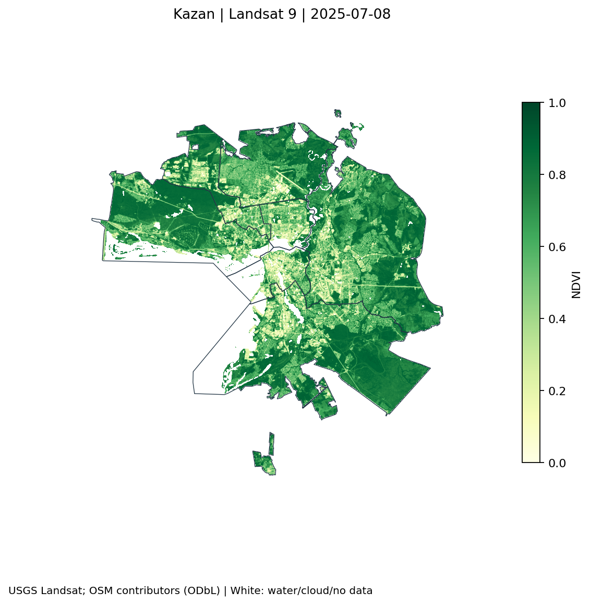
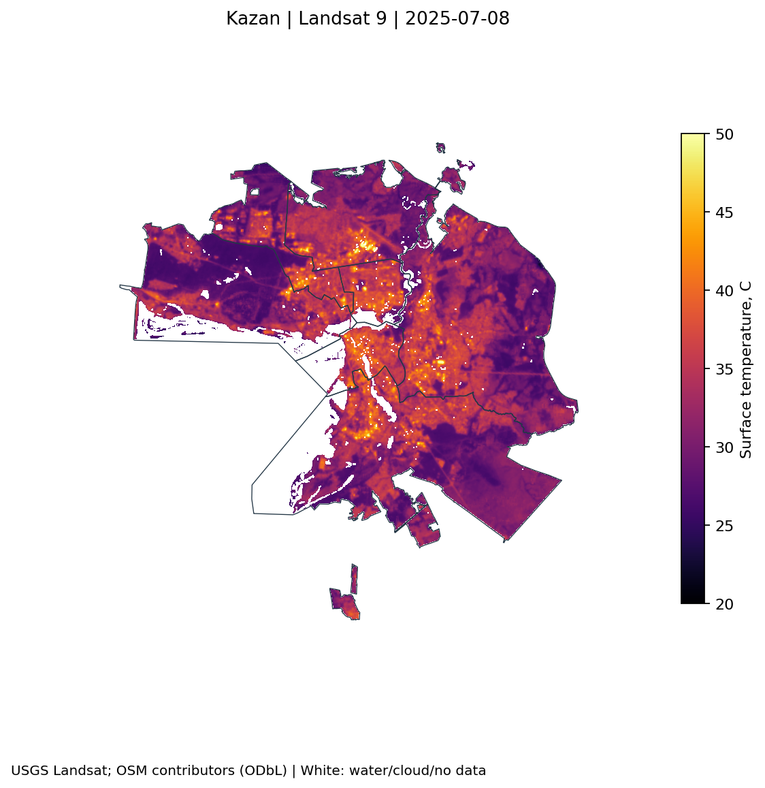

# Проверка качества и осуществимости
Фактический расчёт 22.11.2026. Сцена `LC09_L2SP_171021_20250708_02_T1`, облачность всей сцены 1.18%.
Входы и результаты: data/provenance/, data/processed/summary.json, district_statistics.csv.

## Метод
SR = DN × 0.0000275 − 0.2; NDVI=(NIR−Red)/(NIR+Red). ST=DN × 0.00341802+149 K; LST=ST−273.15 °C.
Источник коэффициентов: [USGS](https://www.usgs.gov/faqs/how-do-i-use-a-scale-factor-landsat-level-2-science-products).
QA_PIXEL исключает биты 0–5 и 7: fill, dilated cloud, cirrus, cloud, shadow, snow, water; QA_RADSAT должен равняться 0. Отрицательная отражательная способность и нулевой знаменатель исключаются. Маска применяется одинаково к NDVI и LST.
Сетки band TIFF сравниваются по CRS, transform и shape. Границы районов обрезаются городом, статистика ограничивается городским mask. Площадь пикселя 30×30 м в UTM исходного снимка; это приближение в проекции.

## Результаты
В границе города 660,274 пикселей; совместно валидных сухопутных 594,768 (90.1% от всей площади, включая исключённую воду). Это НЕ оценка облачности: в знаменателе также вода.

| Район | NDVI | LST, °C | Валидно от всей площади | Кандидатные пиксели, км² |
|---|---|---|---|---|
| Авиастроительный район | 0.652 | 32.16 | 99.4% | 4.90 |
| Вахитовский район | 0.428 | 35.68 | 66.6% | 5.53 |
| Кировский район | 0.681 | 30.08 | 82.8% | 3.89 |
| Московский район | 0.612 | 32.09 | 99.5% | 4.75 |
| Ново-Савиновский район | 0.479 | 35.54 | 88.3% | 4.11 |
| Приволжский район | 0.681 | 31.69 | 84.4% | 8.50 |
| Советский район | 0.663 | 31.90 | 99.4% | 9.22 |

Порог кандидатов: NDVI <0.3 и LST ≥P75=34.66 °C. Площадь таких пикселей 40.90 км². Сохранены 10 крупнейших связных кластеров >=0.5 га. Это не 10 согласованных площадок: возможны крыши, дороги, промзоны и участки с ограничениями.
Корреляция пикселей NDVI–LST r=-0.768. Пространственная автокорреляция не учтена, p-value и причинный эффект не заявляются.

## Что проверено и что ещё требуется
- Семь районов найдены в OSM; геометрии, CRS, ID и границы проверяются скриптом.
- NDVI и LST рассчитаны по одной дате; разность дат исключена.
- Вахитовский район: валидность ниже 80%; нужно отдельно разделить долю воды и прочие потери перед сравнением покрытия.
- Нужны проверка актуальности границ на дату 2025 и независимая проверка 30 стратифицированных точек (центр/окраины). Пока она не проведена.
- Один снимок не позволяет судить о многолетней тенденции. Нужен второй летний снимок для проверки устойчивости списка кандидатов.
- Тепловой канал исходно 100 м, перепроецирован на сетку 30 м; мелкие участки нельзя считать независимыми температурными наблюдениями.

## Вывод об осуществимости
Технически первичный анализ осуществим: реальные снимки получены, карты и CSV строятся. Приёмка аналитических рекомендаций условная до проверки землепользования, устойчивости по датам и заказчиком. Нельзя обещать количественное снижение температуры от посадок.

## Карты

[Интерактивная карта](maps/kazan.html) — открыть сохранённый HTML; GitHub показывает исходник.
© участники OpenStreetMap (ODbL), USGS Landsat.
