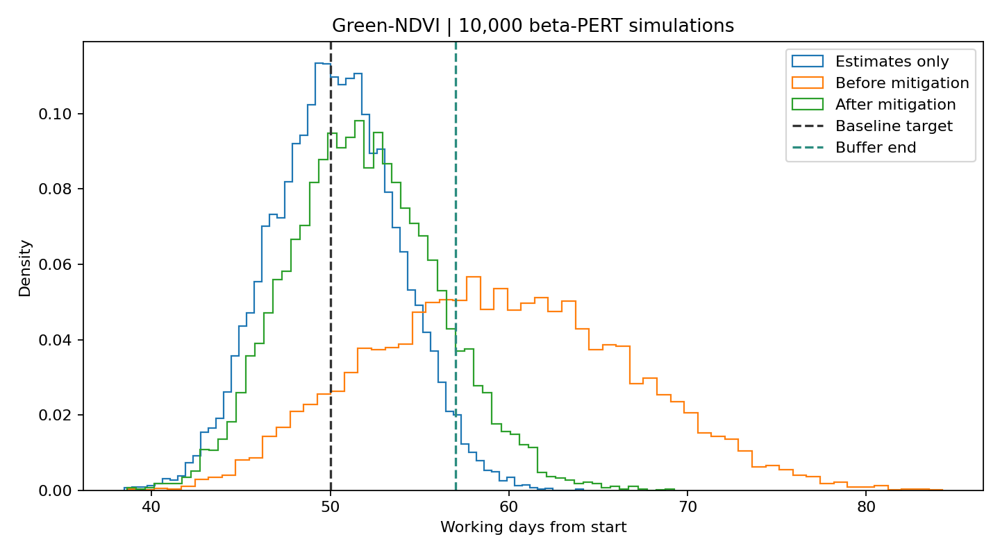
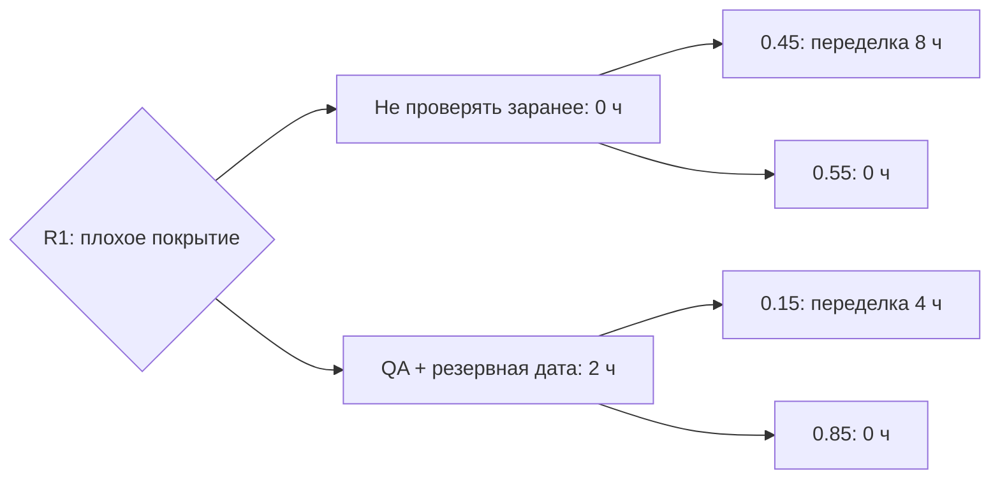

# Реестр рисков Green-NDVI
Версия 1.1 · 22.11.2026 · владелец — Юрий, предложение ответных мер.

## Шкалы и приоритет
Вероятность 1:<10%, 2:10–30%, 3:30–50%, 4:50–70%, 5:>70% за проект. Влияние 1:<=1 дня/2 ч, 2:<=2 дней/5 ч, 3:<=5 дней/10 ч, 4:выше буфера/15 ч или неверный вывод, 5:срыв защиты/непригодный продукт. Берём максимальное влияние на срок, бюджет, качество и ценность. Балл=В×Вл: 15–25 высокий, 8–14 средний, 1–7 наблюдение.

## Реестр
| ID | RBS | Причина → событие → последствие | В×Вл | Стратегия и мера | Триггер | Владелец | Резерв, ч |
|---|---|---|---|---|---|---|---|
| R1 | Данные | Облачность/NoData → недостаточно валидной суши → вывод по району смещён | 3×4=12 | Снизить: QA, второй снимок, показывать покрытие | Покрытие района <80% | Айбулат | 4 |
| R2 | Метод | Крыши и дороги в горячих кластерах → неверные кандидаты → рекомендации непригодны | 3×4=12 | Снизить: 30 точек и проверка землепользования | >20% проверенных точек непригодны | Марис | 6 |
| R3 | Технологии | Тяжёлые растры → карта не открывается → сорван показ | 2×3=6 | Снизить: уменьшенные PNG overlay, локальный HTML | Открытие >5 с на тестовом стенде | Марис | 2 |
| R4 | Команда | Выпадение участника → критический пакет без исполнителя → задержка | 2×4=8 | Снизить: дублёр и инструкция воспроизведения | Нет ответа 2 рабочих дня | Юрий | 1 |
| R5 | Право | Неясная лицензия внешней базы → нельзя публиковать → переделка | 2×5=10 | Избежать: только документированные лицензии | Нет ссылки на условия источника | Юрий | 1 |
| R6 | Сервисы | Отказ каталога/OSM → входы недоступны → задержка обновления | 3×3=9 | Снизить: кэш и резервный Nominatim, сохранённый item | 2 отказа/24 ч | Юрий | 1 |
| R7 | Требования | Новые пожелания после плана → рост объёма → превышение бюджета | 3×3=9 | Принять активно: change Issue и обмен объёмом | Новая Must-история | Менеджер ЛР | 1.2 |
| R8 | Качество | Неверный scale/QA → неверная LST → ошибочное решение | 3×4=12 | Снизить: известные ответы, QA-тесты, CI и ревью | Изменён расчёт без теста | Айбулат | 0 (меры в K/G) |
| R9 | Ценность | Пользователь уже имеет аналог → отчёт не используется → нет выгоды | 2×4=8 | Снизить: сравнить альтернативы и подтвердить 90 тыс./год | Нет подтверждения на обзоре | Юрий | 0 (в F/I) |
| R10 | Календарь | Каникулы/дата защиты неизвестны → план позже дедлайна → срыв сдачи | 4×5=20 | Эскалировать: согласовать календарь до утверждения | Не согласовано начало/конец ЛР 3 | Марис | 0; нужен новый план |
Общий резерв известных рисков 16.2 ч; меры G/K/D уже в базе, не оплачиваются второй раз. Резерв не гарантирует устранение риска. Остаточные риски R1/R2 сохраняются; второй снимок создаёт вторичный риск несопоставимых дат, тяжёлые overlays — риск потери детализации.

## Матрица
| В \ Вл | 1 | 2 | 3 | 4 | 5 |
|---|---|---|---|---|---|
| 5 | — | — | — | — | — |
| 4 | — | — | — | — | R10 |
| 3 | — | — | R6,R7 | R1,R2,R8 | — |
| 2 | — | — | R3 | R4,R9 | R5 |
| 1 | — | — | — | — | — |

## Возможность O1
Открытые данные департамента о пригодных территориях → исключение непригодных кластеров → меньше ручной проверки. В=2, выгода=4, оценка8. Усилить: запросить список через преподавателя; владелец Юрий; триггер — подтверждённый доступ и лицензия. Потенциально экономит 4 ч D, в базовый бюджет экономия не включена. Реального ответа нет.

## Монте-Карло
scripts/plan.py, 10 000 прогонов, seed=20261122. Длительности beta-PERT O=.5M, P=1.5M, λ=4 (beta(3,3)); часы переводятся в дни по 1.2 ч/день. Каждый прогон пересчитывает сеть с ресурсными зависимостями. Четыре независимых события, общие случайные выборки в сценариях. Независимость рисков и постоянная доступность — ограничения модели.
| Риск/работа | Вероятность до/после | Добавочные часы до/после | Добавочные дни до/после |
|---|---|---|---|
| R1/B | .45/.15 | 8/4 | 6.67/3.33 |
| R2/D | .35/.15 | 12/6 | 10/5 |
| R3/E | .25/.10 | 8/4 | 6.67/3.33 |
| R8/C | .30/.10 | 10/3 | 8.33/2.5 |
Эти точечные вероятности экспертные; после мер — целевой сценарий, а не эмпирически доказанное снижение риска.

Цель 50 рабочих дней, с буфером 57, бюджет часов 108+16.2.
| Сценарий | P(50 дней) | P(57 дней) | Дни P50 | Дни P85 | Часы P50 | Часы P85 | P(<=124.2 ч) |
|---|---|---|---|---|---|---|---|
| estimates | 46.9% | 97.2% | 50.29 | 53.98 | 107.89 | 114.18 | 99.6% |
| before | 9.8% | 37.8% | 59.36 | 67.27 | 120.11 | 132.32 | 63.8% |
| after | 34.0% | 88.5% | 51.71 | 56.25 | 109.89 | 116.99 | 97.9% |

После мер P85=56.25 дня; поэтому 5-дневный буфер увеличен до 7. Без мер вероятность попасть даже в новый буфер всего 37.75%. На срок сильнее влияют E (r≈.447), D (.346), L (.295), A/B (.288). Индекс критичности A/B=100%, D≈73.6%, E/H≈99.8%; полная таблица в plan.json. Это показывает слияние путей: задерживается не только исходный CPM-путь.
Спонсору: календарь с праздниками пока неизвестен, R10 в модель не включён; 88.5% — условная вероятность при принятых предположениях, не гарантия сдачи.

## Дерево решений по R1
Стоимость часа 1000 руб. Сравниваем варианты до наступления события.

| Вариант | Сейчас | EMV | Ожидаемая задержка | Худший случай |
|---|---|---|---|---|
| Без ранней проверки | 0 | 0+.45×8000=3600 руб. | .45×8/1.2=3 дня | 6.67 дня |
| QA и резервная дата | 2000 | 2000+.15×4000=2600 руб. | .15×4/1.2=.5 дня после проверки | 3.33 дня после проверки |
Выбран второй: EMV ниже на 1000 руб., меньше хвост задержки. Начальные 2 ч включены в B, вероятность и ущерб после меры — сценарий. Не путать EMV с резервом на худший случай.

## Правовые и этические вопросы
OSM: атрибуция со ссылкой на copyright; производные границы/база по ODbL. Landsat: USGS, дата и item. Sentinel-2 пока не использован. Персональные данные не собираем: только административные полигоны и снимки. Политика публикации команды согласуется отдельно.
Не называть кандидатов «свободными площадками», LST — температурой воздуха, а корреляцию — доказанным охлаждением. Пропуски и доля воды различаются по районам; не ранжировать эффективность властей по одной сцене. Журнал ИИ пока отложен пользователем, этот пункт требований остаётся незавершённым.

## История изменений по фактам подготовки
22.11.2026: снимок и 7 границ получены; отказ Overpass реализовался как проблема, Nominatim сработал. Риск R6 сохраняется для обновлений. Выявлена низкая доля валидных пикселей Вахитовского района; R1 не закрыт. Тест нашёл ошибку в ожидаемом числе теста температуры, эталон исправлен по формуле USGS; это не подтверждение прохождения внешнего CI. Буфер изменён 5→7 дней по расчёту. Ретроспектива и обновление после реального Sprint 1 ещё предстоят.
