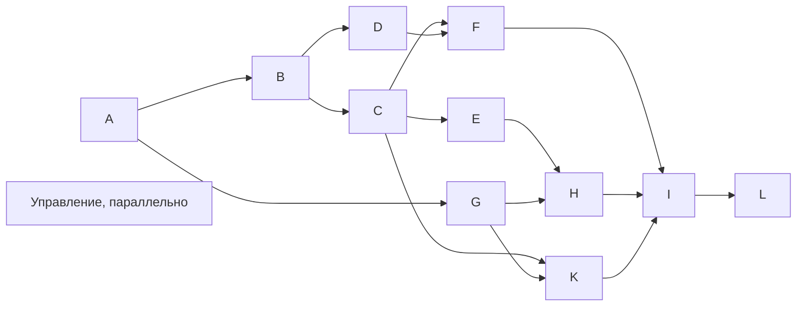
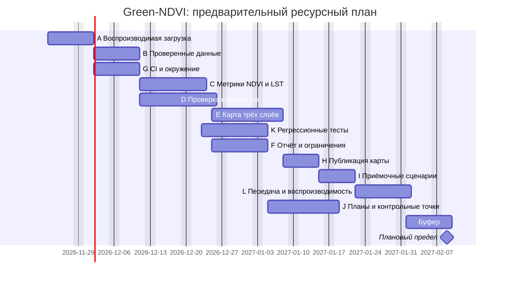

# Календарный и ресурсный план
Базовый план, проект версии 1.0 от 22.11.2026. НЕ утверждён; дата защиты неизвестна.
Вход — WBS и оценки; автоматический расчёт scripts/plan.py, результат data/processed/plan.json.

## Допущения календаря
Начало сценария 23.11.2026; каждый участник 6 ч/неделю =1.2 ч/будний день. Только пятидневная неделя; государственные праздники и университетские каникулы ещё НЕ исключены. Поэтому календарные даты предварительные, относительные рабочие дни — основа расчёта. Дата защиты должна быть согласована до принятия плана. Нельзя считать февраль подтверждённым учебным сроком.

## Сетевой график

## CPM до выравнивания
ES/EF — ранний старт/финиш; LS/LF — поздний; дни от начала, интервалы полуоткрытые.
| ID | Предшественники | Дни | ES | EF | LS | LF | Резерв |
|---|---|---|---|---|---|---|---|
| A | — | 6.67 | 0.00 | 6.67 | 0.00 | 6.67 | 0.00 |
| B | A | 6.67 | 6.67 | 13.33 | 6.67 | 13.33 | 0.00 |
| G | A | 6.67 | 6.67 | 13.33 | 21.67 | 28.33 | 15.00 |
| C | B | 8.33 | 13.33 | 21.67 | 13.33 | 21.67 | 0.00 |
| D | B | 10.00 | 13.33 | 23.33 | 20.00 | 30.00 | 6.67 |
| E | C | 10.00 | 21.67 | 31.67 | 21.67 | 31.67 | 0.00 |
| K | C,G | 8.33 | 21.67 | 30.00 | 28.33 | 36.67 | 6.67 |
| F | C,D | 6.67 | 23.33 | 30.00 | 30.00 | 36.67 | 6.67 |
| H | E,G | 5.00 | 31.67 | 36.67 | 31.67 | 36.67 | 0.00 |
| I | F,H,K | 5.00 | 36.67 | 41.67 | 36.67 | 41.67 | 0.00 |
| L | I | 6.67 | 41.67 | 48.33 | 41.67 | 48.33 | 0.00 |
| J | — | 10.00 | 0.00 | 10.00 | 38.33 | 48.33 | 38.33 |
Критический путь: A → B → C → E → H → I → L. Срок 48.33 рабочего дня.

## Ресурсы и выравнивание
До выравнивания C и K могут накладываться у Айбулата, D и E — у Мариса. Последовательные ресурсные зависимости добавлены в топологическом порядке. Это простая консервативная эвристика, не доказательство оптимальности.
| ID | Владелец | Зависимости с ресурсами | Старт | Финиш | Часы |
|---|---|---|---|---|---|
| A | Юрий | — | 2026-11-23 | 2026-12-01 | 8 |
| B | Айбулат | A | 2026-12-01 | 2026-12-10 | 8 |
| G | Юрий | A | 2026-12-01 | 2026-12-10 | 8 |
| C | Айбулат | B | 2026-12-10 | 2026-12-22 | 10 |
| D | Марис | B | 2026-12-10 | 2026-12-24 | 12 |
| E | Марис | C,D | 2026-12-24 | 2027-01-07 | 12 |
| K | Айбулат | C,G | 2026-12-22 | 2027-01-01 | 10 |
| F | Юрий | C,D,G | 2026-12-24 | 2027-01-04 | 8 |
| H | Марис | E,G | 2027-01-07 | 2027-01-14 | 6 |
| I | Айбулат | F,H,K | 2027-01-14 | 2027-01-21 | 6 |
| L | Марис | I,H | 2027-01-21 | 2027-01-29 | 8 |
| J | Юрий | F | 2027-01-04 | 2027-01-15 | 12 |
После выравнивания нет пересечений работ одного исполнителя и превышения 1.2 ч/день. Срок 50 дней; резерв времени 7 рабочих дней; конец буфера — 2027-02-09. Суммарная ёмкость 12 недель ×18=216 ч, базовые работы 108 ч; незанятая ёмкость других людей не устраняет последовательный критический путь.

| Участник | До выравнивания | После | Базовая нагрузка |
|---|---|---|---|
| Юрий | до 2 параллельных пакетов | <=1.2 ч/день | 36 ч |
| Айбулат | C/K могут идти параллельно | <=1.2 ч/день | 34 ч |
| Марис | D/E могут идти параллельно | <=1.2 ч/день | 38 ч |
J — управленческая трудоёмкость условно сгруппирована; на реальном планировании распределить её между менеджерами и неделями, затем пересчитать ресурсные зависимости.

## Диаграмма Ганта
Для удобства отображения durations округлены вверх; точные дробные даты и зависимости в plan.json. Mermaid исключает выходные; праздники ещё не внесены.

## Спринты и релизы
Итерации по 2 недели, распределение целей уточняется по ресурсным датам. Отчётность преподавателю по ЛР не равна производственному календарю.
| Итерация | Период | Цель | Релиз/контроль |
|---|---|---|---|
| Sprint 1 | 23.11–06.12 | Загрузка, QA и каркас CI; критерии в sprint-1.md | ЛР 4: v0.4 после человеческого ревью |
| Sprint 2 | 07.12–20.12 | Закончить QA, проверить кандидатов, начать расчёты | v0.5 после приёмки |
| Sprint 3 | 21.12–03.01 | Метрики и карта; пересчитать с каникулами | Кандидат v0.6-mvp |
| Sprint 4 | 04.01–17.01 | Карта, тесты и отчёт | Уточнение MVP |
| Sprint 5 | 18.01–31.01 | Приёмка и передача | Кандидат v1.0 |
| Буфер | До 2027-02-09 | Только наступившие риски | Решение спонсора |
Дальнейшие спринты — предложение. Устав ЛР 1 предполагал 14 недель без конкретной даты начала; текущий сценарий не считается его утверждённым переносом.

## Изменение после анализа рисков
Первоначальный буфер 5 дней давал 77.34% завершения после мер, ниже целевых 85%. Буфер увеличен до 7 дней; теперь 88.5%. Изменение требует подтверждения спонсора, не скрытой замены базового плана.
На GitHub Project требуются Estimate, Sprint (Iteration), Start date/Target date, Roadmap и представление текущего спринта; настройки проверяются отдельно, наличие этого документа не означает, что они включены.
