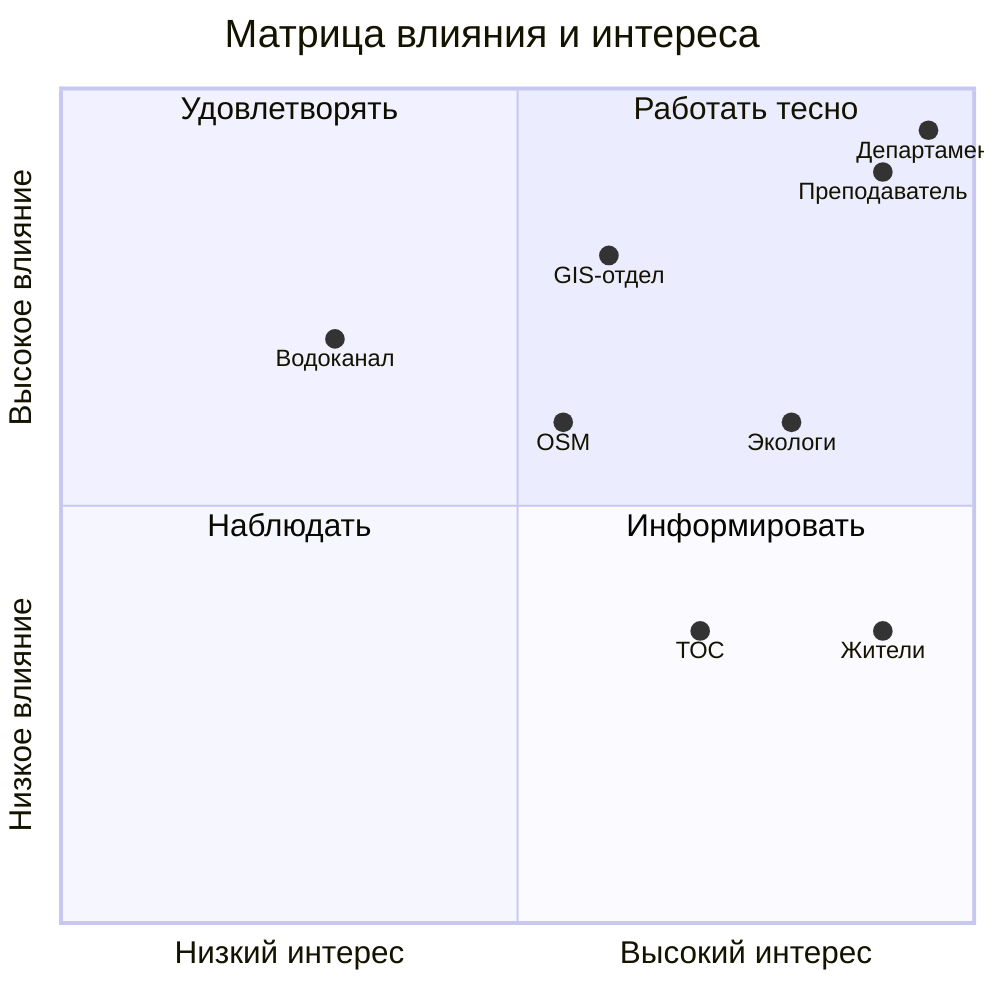

# Стейкхолдеры, матрица влияния и интереса, RACI

## Реестр

| Стейкхолдер | Роль | Что ожидает | Влияние (1–5) | Интерес (1–5) | Как работаем |
|---|---|---|---|---|---|
| Департамент благоустройства Казани | Заказчик | Обоснование, где озеленять в первую очередь | 5 | 5 | Еженедельный статус |
| Преподаватель | Куратор | Соответствие требованиям курса | 5 | 4 | Плотно, на контрольных точках |
| GIS-отдел Казани | Источник данных | Совместимость с городскими границами | 4 | 3 | Согласование форматов |
| Экологи и общественные организации | Пользователи | Открытые данные для контроля | 3 | 4 | Консультации |
| OpenStreetMap | Источник данных | Корректное использование, авторство | 3 | 3 | Следим за лицензией ODbL |
| Водоканал / озеленители | Смежник | Нет лишней нагрузки при посадках | 3 | 2 | Консультации |
| Жители Казани | Пользователи | Понятная карта жары и зелени | 2 | 5 | Информируем, тестируем |
| ТОС (территориальные самоуправления) | Пользователи | Учёт локальных проблем | 2 | 4 | Информируем, тестируем |

## Матрица влияния и интереса

## RACI

| Работа | Менеджер проекта | Аналитик | Тех. организатор | Заказчик |
|---|---|---|---|---|
| Устав проекта | A/R | C | I | C |
| Бизнес-обоснование | A | R | I | C |
| Реестр стейкхолдеров | A | R | I | C |
| Настройка репозитория | A | I | R | I |
| Сбор NDVI и тепловых снимков | A | R | C | I |
| Расчёт тепловых островов | A | R | C | I |
| Веб-карта с слоями | A | C | R | I |
| Приоритизация зон озеленения | A | R | C | C |
| Защита проекта | A/R | C | C | I |

## Интервью с заказчиком

Протокол: [docs/meetings/interview-01.md](meetings/interview-01.md)
