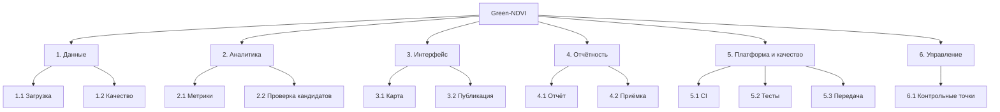

# Иерархическая структура работ
Версия 1.0 · проект базового содержания, требуется согласование.

## Словарь WBS
| Код | Результат | Ответственный (предложение) | M, ч | Готово, когда |
|---|---|---|---|---|
| 1.1 (A) | Воспроизводимая загрузка | Юрий | 8 | TIFF и scene.json воспроизводятся |
| 1.2 (B) | Проверенные данные | Айбулат | 8 | QA-отчёт и семь районов проходят проверки |
| 5.1 (G) | CI и окружение | Юрий | 8 | Ruff/pytest/данные/ноутбуки в CI |
| 2.1 (C) | Метрики NDVI и LST | Айбулат | 10 | CSV и растры совпадают с unit-тестами |
| 2.2 (D) | Проверка кандидатов | Марис | 12 | 10 зон проверены по снимку и землепользованию |
| 3.1 (E) | Карта трёх слоёв | Марис | 12 | Три слоя, легенды и подсказки |
| 5.2 (K) | Регрессионные тесты | Айбулат | 10 | Границы, NoData и ошибочные масштабы покрыты тестами |
| 4.1 (F) | Отчёт и ограничения | Юрий | 8 | Выводы трассируются к CSV и источникам |
| 3.2 (H) | Публикация карты | Марис | 6 | Карта открывается по согласованной ссылке |
| 4.2 (I) | Приёмочные сценарии | Айбулат | 6 | Протокол сценариев и решение заказчика |
| 5.3 (L) | Передача и воспроизводимость | Марис | 8 | Другой участник повторил анализ по инструкции |
| 6.1 (J) | Планы и контрольные точки | Юрий | 12 | Протоколы, план и журнал рисков |

Итого 108 ч. Правило 100%: E1–E5 покрывают данные, расчёт, интерфейс и передачу; E6 включает управление, поэтому оно не добавляется второй раз поверх суммы. Пакеты <8 ч (3.2, 4.2) оставлены как небольшие самостоятельные результаты. Каждая рабочая задача внутри пакета <=6 ч. Источник оценок — инженерное предложение, не проведённый Planning Poker.
ЛР 1 и уже затраченные часы сюда не включены; фактические часы участников неизвестны. Работа ассистента над пакетом подготовки не выдаётся за отработанные участниками 108 ч.
